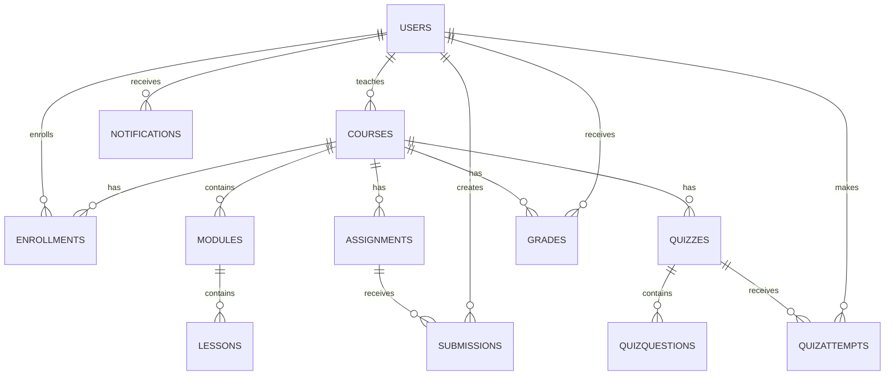

# 04 — Database Design

## 1. Tables

Hệ thống dùng 12 bảng để giữ model đủ thực tế mà vẫn gọn:

1. `Users`
2. `Courses`
3. `Enrollments`
4. `Modules`
5. `Lessons`
6. `Assignments`
7. `Submissions`
8. `Quizzes`
9. `QuizQuestions`
10. `QuizAttempts`
11. `Grades`
12. `Notifications`

## 2. ER overview

## 3. Design decisions

### Role không tách bảng
Chỉ có 3 role cố định, nên dùng `Users.Role` với CHECK constraint thay vì `Roles` + `UserRoles`. Việc này giảm join và giảm code không cần thiết.

### Quiz options dùng JSON
`QuizQuestions.OptionsJson` lưu options cho SINGLE_CHOICE. Với scope nhỏ, cách này tránh thêm bảng `QuestionOptions` chỉ để phục vụ MCQ. `CorrectAnswer` lưu key đáp án, ví dụ `B` hoặc `true`.

### Quiz answers dùng JSON
`QuizAttempts.AnswersJson` lưu map `{questionId: answer}`. Đủ cho MVP, giảm số bảng và transaction phức tạp.

### Grade là bảng tổng hợp
`Grades` hỗ trợ `ASSIGNMENT`, `QUIZ`, `MANUAL`. Nó giúp gradebook query đơn giản và giữ lịch sử kết quả hiện tại ở một nơi.

## 4. Important constraints

- Email unique.
- CourseCode unique.
- `(CourseId, StudentId)` unique trong Enrollment.
- `(AssignmentId, StudentId)` unique trong Submission.
- `(QuizId, StudentId, AttemptNo)` unique trong QuizAttempt.
- Score luôn >= 0 và <= MaxScore phải được validate ở service layer.
- LecturerId phải trỏ đến user role LECTURER: SQL FK không kiểm được role nên service phải enforce.
- StudentId phải trỏ đến STUDENT trong enrollment/submission/attempt/grade: service enforce.

## 5. Delete strategy

Không cascade delete dây chuyền. Với record đã dùng, ưu tiên đổi status/archive. SQL dùng `NO ACTION` để tránh xóa nhầm dữ liệu học tập.

## 6. Seed strategy

`02_seed.sql` cung cấp tối thiểu 10 record cho **mỗi bảng**. Seed dùng GUID có pattern dễ đọc để demo/query thuận tiện.
