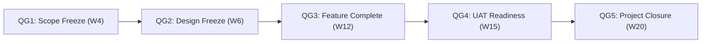

> **Tài liệu đồ án học thuật mô phỏng.** Vai trò, ước tính, giả định, trạng thái và biên bản trong kế hoạch này không phải bằng chứng thực thi hoặc phê duyệt thực tế.

# 09 — Kế hoạch Quản lý Chất lượng & Cổng Kiểm soát (Quality Plan & Quality Gates)

## 1. Mục tiêu Chất lượng (Quality Objectives)
1. **Tuân thủ chức năng:** 100% các yêu cầu nghiệp vụ bắt buộc (Must-have FR-01 đến FR-13) chạy chính xác theo kịch bản chấp nhận.
2. **An toàn & Phân quyền:** Không có lỗ hổng rò rỉ dữ liệu trái quyền (RBAC, Course Isolation, Draft Protection, Quiz Secret Protection).
3. **Mức độ khiếm khuyết:** Đạt **0 lỗi P0 và 0 lỗi P1** khi bước vào UAT và đóng dự án.
4. **Tính nhất quán của dữ liệu:** Dữ liệu mẫu (Seed Data) nạp thành công 100%, vượt qua kiểm tra toàn vẹn `04_seed_validation.sql`.
5. **Tính tài liệu hóa:** 100% API chính được đặc tả bằng OpenAPI/Swagger; tài liệu quản lý dự án đối soát khớp số liệu 100%.

---

## 2. Tiêu chuẩn Phân loại Khiếm khuyết (Defect Severity Baseline)

| Mức độ nghiêm trọng (Severity) | Định nghĩa & Tác động | Quy tắc nghiệm thu (Acceptance Rule) | Thời gian phản hồi tối đa |
|---|---|---|---|
| **P0 — Khẩn cấp (Blocker / Critical)** | Hệ thống ngừng hoạt động (Crash), mất mát dữ liệu nghiêm trọng, không thể đăng nhập hoặc không thể tiếp tục quy trình kiểm thử. | **Bắt buộc 0 lỗi mở** trước khi chuyển giai đoạn. | Xử lý ngay lập tức ($< 4$ giờ công). |
| **P1 — Nghiêm trọng (Major)** | Luồng nghiệp vụ cốt lõi bị lỗi (nộp bài thất bại, chấm điểm sai, sinh viên xem được đáp án thi, phân quyền bị bypass). | **Bắt buộc 0 lỗi mở** trước khi bắt đầu UAT và Closure. | Xử lý trong vòng 24 giờ ($< 8$ giờ công). |
| **P2 — Trung bình (Normal)** | Chức năng phụ hoạt động không đúng nhưng có giải pháp thay thế tạm thời (Workaround), lỗi hiển thị nhỏ không ảnh hưởng logic. | Cho phép tồn tại tối đa $\le 3$ lỗi nếu có tài liệu giải trình. | Xử lý trong vòng 3 ngày làm việc. |
| **P3 — Nhẹ (Minor / Cosmetic)** | Lỗi giao diện, lỗi chính tả, căn lề chưa chuẩn, thông điệp người dùng chưa tối ưu. | Được phép chấp nhận và hoãn sang phiên bản nâng cấp tiếp theo. | Xử lý theo đợt cập nhật giao diện. |

---

## 3. Các Cổng Kiểm soát Chất lượng (Quality Gates - QG)

Dự án áp dụng 5 cổng kiểm soát chất lượng nghiêm ngặt; không được phép vượt cổng nếu chưa thỏa mãn điều kiện tiên quyết:

### QG1: Phê duyệt Bản cơ sở Phạm vi (Scope Baseline Approval — Cuối Tuần 4)
- **Điều kiện vượt cổng:** Tài liệu đặc tả yêu cầu (SRS), danh sách Use Cases và cấu trúc WBS Level 3 được thống nhất; ranh giới In-scope / Out-of-scope được Sponsor và BA ký xác nhận.

### QG2: Đóng băng Thiết kế (Design Baseline Freeze — Cuối Tuần 6)
- **Điều kiện vượt cổng:** Kiến trúc Modular Monolith, sơ đồ quan hệ 12 bảng CSDL SQL Server và hợp đồng API Spec được thẩm định; không có xung đột về khóa chính, khóa ngoại hay kiểu dữ liệu.

### QG3: Hoàn thiện Tính năng có Kiểm thử Phân quyền (Feature Complete Gate — Cuối Tuần 12)
- **Điều kiện vượt cổng:** Toàn bộ vertical slices chức năng (Auth, Course, Lesson, Assignment, Quiz, Grade) hoàn thành; các kịch bản chặn quyền (Principal Denial Paths) được kiểm tra tại server-side; không còn endpoint mở chưa xác thực.

### QG4: Sẵn sàng cho Nghiệm thu Người dùng (UAT Readiness Gate — Cuối Tuần 15)
- **Điều kiện vượt cổng:** Bộ kiểm thử tự động Pytest bao phủ 10 kịch bản chấp nhận (AC-01 đến AC-10) pass 100%; số lỗi P0 và P1 bằng 0; dữ liệu seed mẫu được nạp sạch sẽ trên môi trường demo.

### QG5: Đóng Dự án & Nghiệm thu Toàn diện (Project Closure Gate — Cuối Tuần 20)
- **Điều kiện vượt cổng:** Biên bản UAT có đầy đủ chữ ký; số liệu tài liệu QLDA nhất quán 100%; toàn bộ bằng chứng kiểm thử và mã nguồn được đóng gói đầy đủ.

---

## 4. Định nghĩa Hoàn thành cho từng Tính năng (Definition of Done - DoD)
Một tính năng chỉ được xem là "HOÀN THÀNH" (Done) khi thỏa mãn toàn bộ các tiêu chí sau:
1. **Nghiệp vụ:** Logic quy tắc nghiệp vụ (BR) được cài đặt đầy đủ theo đặc tả.
2. **Bảo mật & Phân quyền:** Cả luồng hợp lệ (Happy path) và luồng từ chối trái quyền (Denial path) đều được kiểm soát và kiểm thử tại server-side.
3. **Kiểm thử tự động:** Có test case Pytest tương ứng chạy pass 100%.
4. **Tài liệu hóa API:** Endpoint hiển thị chính xác trên Swagger/OpenAPI docs với schema request/response rõ ràng.
5. **Giao diện (Frontend):** UI xử lý đầy đủ các trạng thái: Đang tải (Loading), Thành công (Success), Lỗi (Error) và Dữ liệu rỗng (Empty state).
6. **Không nợ kỹ thuật nghiêm trọng:** Không hard-code `user_id` hay `role` phía client; không để lại mã giả (mock/fake) trong luồng chính.

---

## 5. Chiến lược Kiểm thử (Testing Strategy)
- **Unit Test (Pytest):** Tập trung vào các quy tắc nghiệp vụ cốt lõi: kiểm tra hạn nộp bài (BR-05), thang điểm chấm 0-MaxScore (BR-06), tự động chấm trắc nghiệm (BR-08), kiểm tra khung giờ và lượt làm quiz (BR-07, BR-09).
- **Integration & API Test:** Dùng `TestClient` kiểm tra các luồng xác thực JWT, RBAC 403 Forbidden, bảo vệ đáp án trắc nghiệm sinh viên, và cô lập nội dung giữa các giảng viên.
- **System & Smoke Test:** Kiểm tra luồng dữ liệu end-to-end trên CSDL SQL Server thật với 120 dòng seed data chuẩn.
