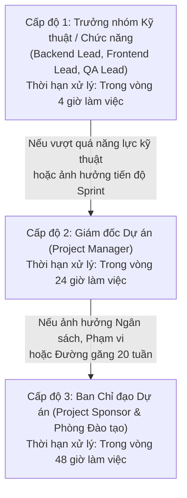

# 10 — Kế hoạch Quản lý Truyền thông (Communication Management Plan)

## 1. Mục tiêu Truyền thông
- Đảm bảo thông tin dự án được truyền đạt chính xác, kịp thời, đúng đối tượng và đúng kênh.
- Tối ưu hóa việc phối hợp giữa đội ngũ kỹ thuật và các bên liên quan học vụ (Ban Giám hiệu, Phòng Đào tạo, Giảng viên, Sinh viên).
- Cung cấp cơ chế báo cáo tiến độ minh bạch và quy trình leo thang vấn đề (Escalation) rõ ràng khi phát sinh rào cản.

---

## 2. Ma trận Ma trận Kế hoạch Truyền thông (Communication Matrix)

| Đối tượng tiếp nhận (Audience) | Nội dung thông tin (Content) | Tần suất (Frequency) | Hình thức / Kênh truyền thông (Channel) | Người chịu trách nhiệm (Owner) | Đầu ra / Bằng chứng (Deliverable) |
|---|---|---|---|---|---|
| **Ban Giám hiệu / Sponsor (SH-01)** | Báo cáo tiến độ tổng quan, tình hình giải ngân ngân sách, mốc tiến độ chính và rủi ro lớn. | 2 tuần / lần (Bi-weekly) | Họp trực tiếp & Báo cáo quản trị (Executive Summary) | Project Manager | Biên bản họp & Slide báo cáo mốc |
| **Phòng Đào tạo (SH-02)** | Tiến độ chi tiết các luồng học vụ, kế hoạch nghiệm thu UAT, cập nhật danh sách khóa học pilot. | Hàng tuần (Weekly) trong giai đoạn khảo sát & UAT | Họp điều phối & Email tổng hợp | Business Analyst & PM | Tài liệu SRS, Kịch bản UAT |
| **Phòng CNTT (SH-03)** | Cấu hình máy chủ, bảo mật kết nối SQL Server, cấp phát tài nguyên demo và kế hoạch backup. | Khi khởi tạo & trước các mốc phát hành (Milestone) | Họp kỹ thuật & Văn bản thỏa thuận hạ tầng | DevOps & Backend Lead | Bản thông số cấu hình môi trường |
| **Đội ngũ Dự án (Core Team)** | Rà soát công việc tuần, thảo luận giải pháp kỹ thuật, tháo gỡ khó khăn (Blockers). | Đầu tuần (Thứ Hai) & Cuối tuần (Thứ Sáu) | Họp giao ban nội bộ & Bảng công việc Kanban (Jira) | Project Manager | Nhật ký công việc & Burn-down chart |
| **Đội ngũ Dev & QA** | Triage lỗi phát sinh, cập nhật kết quả kiểm thử tự động, thống nhất schema API. | 2 lần / tuần trong giai đoạn Test (Tuần 13-15) | Cuộc họp kỹ thuật 30 phút & Issue Tracker | QA Lead & Backend Lead | Danh sách Defect Triage Log |
| **Đại diện Giảng viên (SH-04)** | Hướng dẫn sử dụng tính năng tạo bài giảng, chấm điểm, thi trắc nghiệm; tiếp nhận phản hồi trải nghiệm. | 3 đợt Workshop & Hỗ trợ thường xuyên | Workshop trực tiếp & Nhóm trao đổi hỗ trợ | BA & UI/UX Designer | Biên bản đóng góp ý kiến |
| **Đại diện Sinh viên (SH-05)** | Thông báo tài khoản thử nghiệm, hướng dẫn đăng nhập, nộp bài tập và làm bài kiểm tra trắc nghiệm. | Trước đợt UAT (Tuần 16) | Email thông báo & Cẩm nang hướng dẫn PDF | BA | Phiếu khảo sát phản hồi người học |

---

## 3. Quy trình Leo thang Vấn đề (Escalation Path)

Khi xuất hiện sự cố kỹ thuật hoặc tranh chấp vượt quá thẩm quyền giải quyết thông thường, quy trình leo thang được thực hiện qua 3 cấp độ:



- **Cấp độ 1 (Level 1 - Technical Level):** Các vấn đề về code bug, cấu hình môi trường cục bộ, xung đột API giữa FE và BE. Người giải quyết: Backend Lead / Frontend Lead / QA Lead trong vòng 4 giờ.
- **Cấp độ 2 (Level 2 - Management Level):** Các vấn đề về chậm tiến độ nhiệm vụ trên đường găng $> 2$ ngày, yêu cầu thay đổi nghiệp vụ nhỏ, nhân sự nghỉ ốm. Người giải quyết: Project Manager trong vòng 24 giờ.
- **Cấp độ 3 (Level 3 - Governance Level):** Các đề xuất thay đổi vượt thẩm quyền (ảnh hưởng ngân sách 1,2 tỷ, hoãn mốc tiến độ chính, tranh chấp quy trình học vụ lớn). Người giải quyết: Ban Giám hiệu (Sponsor) & Trưởng phòng Đào tạo tại cuộc họp đột xuất.

---

## 4. Mẫu Báo cáo Tiến độ Định kỳ (Status Report Template)

```text
BÁO CÁO TIẾN ĐỘ DỰ ÁN (PROJECT STATUS REPORT)
Dự án: University LMS Implementation | Kỳ báo cáo: Tuần [X] / 20
Người lập: Project Manager | Ngày lập: [DD/MM/YYYY]

1. TÌNH TRẠNG CHUNG (OVERALL STATUS): [XANH - Đúng tiến độ / VÀNG - Cần theo dõi / ĐỎ - Chậm tiến độ]
2. KẾT QUẢ ĐẠT ĐƯỢC TRONG KỲ (KEY ACCOMPLISHMENTS):
   - Hoàn thành WBS [ID]: [Tên gói công việc]
   - Bàn giao sản phẩm: [Tên deliverable]
3. KẾ HOẠCH KỲ TIẾP THEO (PLANNED ACTIVITIES):
   - Triển khai WBS [ID]: [Tên gói công việc]
   - Chuẩn bị mốc kiểm soát: [Tên mốc Milestone]
4. VẤN ĐỀ VÀ RỦI RO CẦN HỖ TRỢ (ISSUES & RISKS):
   - Vấn đề phát sinh: [Mô tả] -> Đề xuất giải pháp: [Giải pháp]
5. TÌNH HÌNH NGÂN SÁCH (COST SUMMARY):
   - Ngân sách giải ngân lũy kế: [XXX] VNĐ / 1.200.000.000 VNĐ
```
