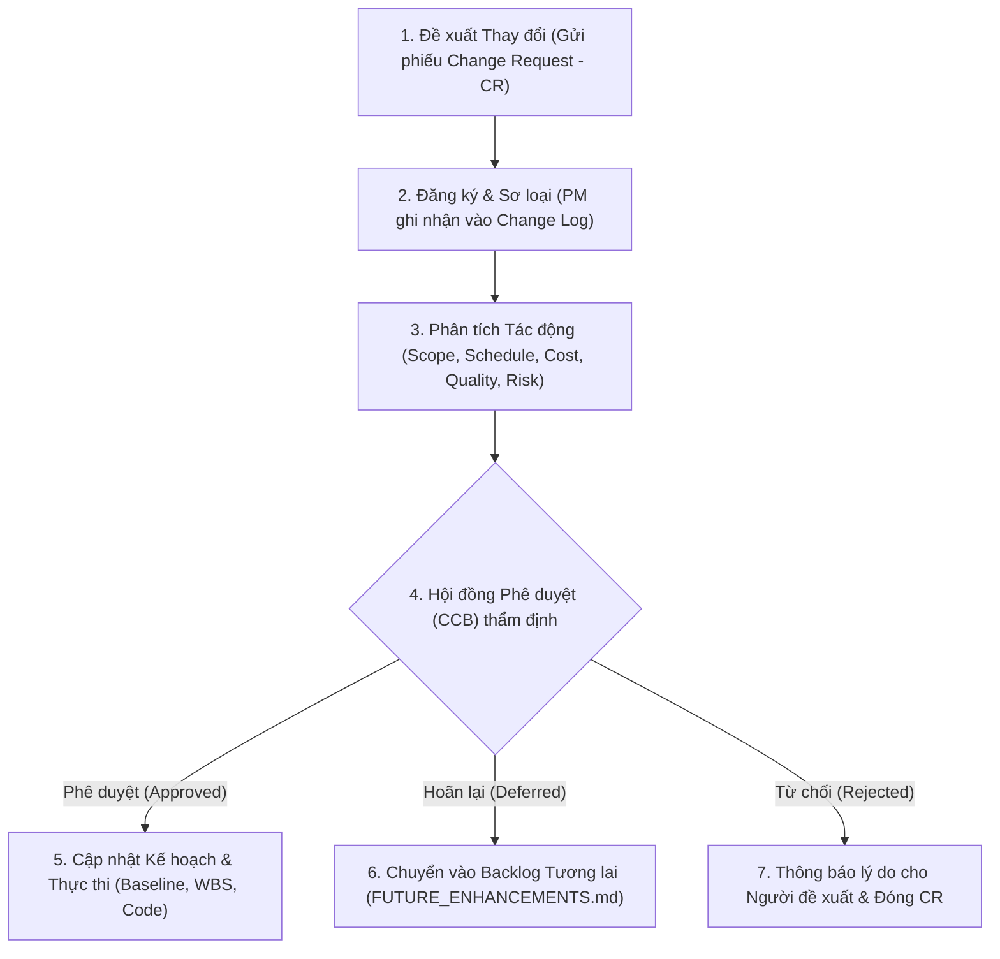

> **Tài liệu đồ án học thuật mô phỏng.** Vai trò, ước tính, giả định, trạng thái và biên bản trong kế hoạch này không phải bằng chứng thực thi hoặc phê duyệt thực tế.

# 11 — Kế hoạch Quản lý Thay đổi (Change Management Plan)

## 1. Mục đích & Nguyên tắc Quản lý Thay đổi
Trong quá trình thực hiện dự án University LMS, các yêu cầu thay đổi có thể xuất phát từ người dùng, ban quản lý hoặc lý do kỹ thuật. Mục tiêu của quy trình quản lý thay đổi là:
- Đảm bảo mọi đề xuất thay đổi đều được ghi nhận, phân tích tác động và phê duyệt minh bạch.
- Ngăn chặn triệt để tình trạng "phình to phạm vi" (Scope Creep) làm vỡ đường găng 20 tuần và ngân sách trần 1,2 tỷ VNĐ.
- Duy trì tính đồng bộ của toàn bộ hồ sơ quản lý dự án khi có thay đổi được chấp thuận.

### Nguyên tắc xử lý mặc định (Default Deferral Rules):
Các tính năng sau đây mặc định bị **TỪ CHỐI hoặc HOÃN (REJECT / DEFER)** sang phiên bản tương lai, không được đưa vào scope của đồ án:
1. Trợ lý ảo AI / Tự động chấm bài luận bằng AI (AI Tutoring).
2. Phòng học trực tuyến / Video Call thời gian thực.
3. Hệ thống chat tin nhắn thời gian thực (Realtime chat/Websocket).
4. Kiến trúc Microservices hoặc Kubernetes.
5. Tích hợp cổng thanh toán học phí hoặc đăng ký học tín chỉ phức tạp.

---

## 2. Quy trình Kiểm soát Thay đổi (Change Control Workflow)



### Thành phần Hội đồng Kiểm soát Thay đổi (Change Control Board - CCB):
1. **Chủ tịch CCB:** Project Sponsor (Ban Giám hiệu nhà trường).
2. **Ủy viên nghiệp vụ:** Trưởng phòng Đào tạo (Business Owner).
3. **Ủy viên kỹ thuật:** Technical Lead / Trưởng phòng CNTT.
4. **Thư ký & Điều phối:** Project Manager (PM).

---

## 3. Biểu mẫu Yêu cầu Thay đổi Chuẩn (Change Request Form Template)

```text
PHIẾU ĐỀ XUẤT THAY ĐỔI (CHANGE REQUEST FORM)
Mã yêu cầu (CR ID): CR-[NĂM]-[SỐ THỨ TỰ] (Ví dụ: CR-2026-001)

1. THÔNG TIN CHUNG:
   - Tên đề xuất thay đổi: ................................................................
   - Người đề xuất: ................................... Chức vụ/Đơn vị: ................
   - Ngày gửi yêu cầu: [DD/MM/YYYY] | Mức độ ưu tiên: [Khẩn cấp / Cao / Vừa / Thấp]

2. MÔ TẢ CHI TIẾT THAY ĐỔI:
   - Hiện trạng (Hiện tại hệ thống đang như thế nào?): .................................
   - Nội dung thay đổi đề xuất: ......................................................
   - Lý do / Lợi ích mang lại: .......................................................

3. BÁO CÁO PHÂN TÍCH TÁC ĐỘNG (DO ĐỘI DỰ ÁN THỰC HIỆN):
   - Tác động đến Phạm vi (Scope Impact): ............................................
   - Tác động đến Tiến độ (Schedule Impact): Tăng/Giảm bao nhiêu tuần/ngày? ............
     (Có ảnh hưởng đến hoạt động trên đường găng hay không?)
   - Tác động đến Chi phí (Cost Impact): Tăng/Giảm bao nhiêu VNĐ? .....................
     (Có sử dụng quỹ dự phòng rủi ro 120 triệu VNĐ hay không?)
   - Tác động đến Rủi ro & Chất lượng (Risk/Quality Impact): ..........................

4. KHUYẾN NGHỊ CỦA PROJECT MANAGER:
   [ ] Phê duyệt (Approve)   [ ] Từ chối (Reject)   [ ] Hoãn (Defer to future)
   - Lý do khuyến nghị: ..............................................................

5. QUYẾT ĐỊNH CỦA HỘI ĐỒNG CCB (CHANGE CONTROL BOARD DECISION):
   - Quyết định chính thức: [ ĐÃ PHÊ DUYỆT / TỪ CHỐI / HOÃN LẠI ]
   - Ngày quyết định: [DD/MM/YYYY]
   - Chữ ký Đại diện CCB: .............................................................
```

---

## 4. Nhật ký Quản lý Thay đổi Thực tế (Project Change Log Example)

| Mã CR | Ngày đề xuất | Người đề xuất | Tóm tắt nội dung thay đổi | Phân tích tác động | Quyết định CCB | Ghi chú xử lý |
|---|---|---|---|---|:---:|---|
| **CR-01** | Tuần 5 | Đại diện Giảng viên | Thêm tính năng chat thảo luận trực tiếp giữa sinh viên và giảng viên trong khóa học. | Scope: Thêm module chat; Schedule: +3 tuần; Cost: +60 triệu VNĐ. Làm trễ đường găng. | **DEFERRED (Hoãn)** | Ghi nhận vào `FUTURE_ENHANCEMENTS.md` cho giai đoạn 2; giữ nguyên baseline prototype. |
| **CR-02** | Tuần 8 | Phòng Đào tạo | Bổ sung trường thông tin `StudentCode` (MSSV) và `StaffCode` (Mã GV) trong tài khoản người dùng để phục vụ quản lý học vụ. | Scope: Nhỏ; Schedule: 0 ngày (lồng vào thiết kế bảng Users); Cost: 0 VNĐ; Không lệch đường găng. | **APPROVED (Duyệt)** | Đã cập nhật vào schema CSDL `01_schema.sql` và model Pydantic tương ứng. |
| **CR-03** | Tuần 11 | Đại diện Sinh viên | Tích hợp cổng thanh toán trực tuyến tiền mua giáo trình học tập. | Scope: Lớn; Schedule: +4 tuần; Rủi ro bảo mật tài chính cao; Out-of-scope đồ án. | **REJECTED (Từ chối)** | Bác bỏ vì vi phạm Scope baseline môn học; hướng dẫn sinh viên thanh toán qua kênh kế toán trường. |
| **CR-04** | Sau Baseline (Đợt mở rộng học thuật 1) | Hội đồng chuyên môn & Nhóm kỹ thuật | Nâng cấp Prototype từ 12 bảng lên 19 bảng: bổ sung Kho tệp an toàn (`StoredFiles`), Tự ghi danh/Mã lớp, Phòng học trực tuyến & Bảng trắng/Chat (`Meetings`, `CourseMessages`, `WhiteboardSnapshots`), Tiến độ bài học (`LessonProgress`) và Trợ lý AI (`AiInteractionLogs`). | Không làm thay đổi Baseline 20 tuần / 1,2 tỷ VNĐ của Giai đoạn 1; triển khai như nhánh nâng cấp nguyên mẫu sau nghiệm thu baseline (`20261113_01`). | **APPROVED (Mở rộng sau Baseline)** | Giữ nguyên các văn kiện kế hoạch gốc (`01..10`) làm hồ sơ đối chứng baseline; cập nhật DDL `01_schema.sql` và `PROJECT.md`. |
| **CR-05** | Sau Baseline (Đợt mở rộng học thuật 2) | Phòng Đào tạo (Mô phỏng) | Bổ sung quản lý vòng đời Học kỳ (`AcademicSemesters`), mã lớp học phần (`SectionCode`), nhập/nhân bản khóa học hàng loạt và Thời khóa biểu chống trùng lịch (`CourseSessions`). | Mở rộng CSDL lên 21 bảng (`20261117_01`, `20261117_02`); bảo toàn toàn bộ hợp đồng API cốt lõi và bộ kiểm thử hồi quy. | **APPROVED (Mở rộng sau Baseline)** | Phản ánh đầy đủ trong `01_schema.sql`, `START_SYSTEM.bat`, `README.md` và `PROJECT.md`. |
